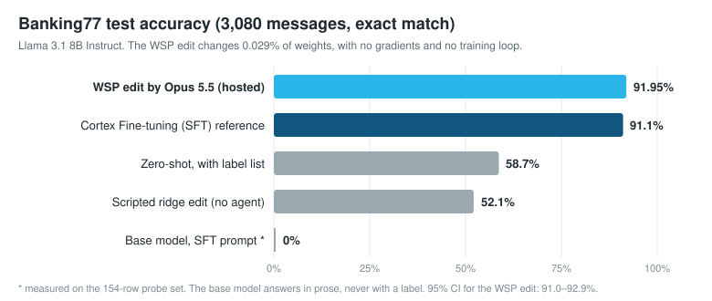
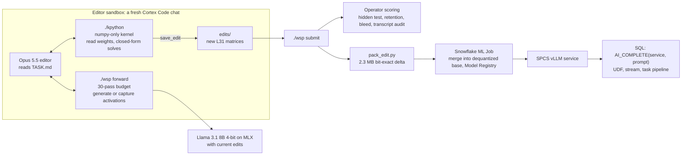
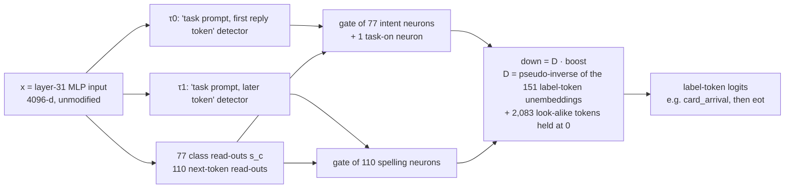

# Banking77 by weight-space programming

**Can an AI agent replace fine-tuning by editing a model's weights directly?** Here, yes, on one benchmark.

Claude Opus 5.5, working as a sandboxed agent, was handed the raw weights of Llama 3.1 8B Instruct. It had numpy and a budget of 30 forward passes. It had no gradients, no optimizer and no training loop. It wrote a 77-way banking intent classifier into 188 neurons of layer 31: 2.31M weights, **0.029% of the model**. The edited model scores **91.95%** on the held-out Banking77 test set. That is level with a gradient-trained reference (91.1%), and the edit leaves the model's general behavior intact.

The edit was then hosted in Snowflake and called from SQL with `AI_COMPLETE`. Classifying all 3,080 test messages through SQL takes about 30 seconds.

This is an application of [*Sparks of Weight-Space Programming*](https://rikiyat.github.io/blog/weight-space-programming/) (Takehi, Teoh, Zhang & Khattab, MIT CSAIL, Nov 2026) to a practical task: replacing a supervised fine-tune with a direct weight edit.

---

## Results

All numbers are exact match on the standard Banking77 test split (3,080 messages, 40 per intent), unless noted otherwise. Scoring is `REPLACE(LOWER(TRIM(reply)), ' ', '') = LOWER(label)`, the same as the fine-tuning benchmark.

| Approach | Accuracy | Macro-F1 | Off-label replies |
|---|---|---|---|
| B0: base model, task prompt (154-row probe) | 0% | 0.00 | 100% |
| B2: scripted closed-form ridge edit of L31 `down_proj` (no agent) | 52.1% | 0.60 | 43% |
| B1: base model, zero-shot with the full label list | 58.7% | 0.57 | 0.1% |
| Reference: Snowflake Cortex Fine-tuning, llama3.1-8b, PEFT, 3 epochs | 91.1% | 0.911 | – |
| **WSP edit by Opus 5.5 (v3), local 4-bit runtime** | **91.95%** | **0.922** | 0.6% |
| **WSP edit by Opus 5.5 (v3), hosted in Snowflake via `AI_COMPLETE`** | **91.95%** (2832/3080, 95% CI 91.0–92.9) | **0.922** | 0.6% |

**General behavior is preserved.** These checks use prompts the editor never saw:
- **Retention:** 40/40 general-knowledge questions the original model answered correctly are still correct.
- **Bleed:** 0 intent labels appear in replies to unrelated prompts.

On its own self-written check set of 748 prompts, the editor also measured 131/131 retention and 0 bleed. That set includes 130 prompts in the exact task format for *other* domains, such as e-commerce and healthcare intents. Those still get normal prose answers.

**The editor's progression** on the 770-message dev set. Dev was held out from fitting and used only to measure.

| Edit | Change | Dev accuracy |
|---|---|---|
| v1 | 188 repurposed L31 neurons | 89.9% |
| v2 | branch weighting, legal-continuation targets | 90.8% |
| v3 (submitted) | weaker off-task penalty, ridge μ = 2e-4 | 91.2% |

The editor submitted after 15 of its 30 passes, about 11 hours of wall-clock time on an M4 MacBook (16 GB). Most of that time was forward passes at about 130 tokens per second.

---

## How it works

### 1. The sandbox

[`harness/TASK.md`](harness/TASK.md) is the full brief. The editor gets:
- the weights, readable through a numpy-only kernel ([`wsp_kernel.py`](harness/wsp_kernel.py));
- 9,233 practice messages and 770 dev messages;
- a forward-pass tool, `./wsp`, with a hard budget of 30 passes.

Each pass either *generates* replies for up to 10,000 prompts, or *captures* internal states (residual stream, MLP input/activations) at chosen layers and positions.

The rules come from the WSP paper:
- No gradient descent, autograd, optimizers or iterative fitting.
- The network can only run through `./wsp`. No simulating layers in numpy.
- No internet, other models, Snowflake, or files outside the folder.
- The output layer, final norm and embeddings cannot be edited.

Closed-form solves (ridge regression, pseudo-inverses) on recorded activations are allowed. So is picking a few scalar settings by comparing passes.

The 3,080-row test set never existed on the laptop during the run. It lived only in Snowflake, which the sandbox could not reach.

After the run, [`harness/audit.py`](harness/audit.py) scanned the editor's full transcript. It found 229 tool calls (bash, write and read only) and no rule violations. See [`runs/editor/opus55_r1/audit.md`](runs/editor/opus55_r1/audit.md).

### 2. What the editor found and built

The complete working folder is in [`editor_workspace/opus55_r1/`](editor_workspace/opus55_r1/). It contains the editor's [lab notebook](editor_workspace/opus55_r1/notes.md), its [final answer](editor_workspace/opus55_r1/final_answer.md), every pass request, and ~70 analysis scripts with their outputs. Summary:

1. **Look before writing.** Linear probes showed the final layer (31) carries intent as well as any earlier layer, at about 0.87 step-0 accuracy with shrinkage LDA.
2. **Read-out first.** A closed-form ridge read-out from layer 31's MLP input reached about 0.91 accuracy on the 77-way class. This is the "knowledge" the edit needs to surface.
3. **A naive edit leaks.** An ungated `down_proj` read-out flipped 15% of general-text positions to label tokens. That is the B2 baseline's failure mode (43% off-label). So the edit needs a multiplicative **task gate**.
4. **Repurpose quiet neurons.** The editor freed the 188 layer-31 neurons with the least output energy on general text. They carry 7.7e-4 of the layer's output energy. It rewired them with SwiGLU, where each neuron computes `h = silu(gate·x) · (up·x)`:

- At the first reply token, the intent neuron with the most mass picks the label's first token.
- The 110 spelling neurons then follow the label's tokens to `<|eot_id|>`.
- Off-task, the gate is far negative, so `silu ≈ 0` and the neurons are silent. Where τ0 < 0, the up factor turns any residual output negative, which suppresses label tokens instead of adding them.
- Every vector comes from one closed-form ridge solve or pseudo-inverse on recorded activations. Scalar settings were chosen by 5-fold cross-validation on practice and by comparing dev passes.
5. **Know the ceiling.** Every alternative tried topped out at about 92.5–93% first-token accuracy from layer-31 features: LDA, pairwise experts, a second aggregation layer, per-branch experts, and higher gains. A two-stage edit using layer 28 carried about 0.6% more information. The editor rejected it because the intermediate code was 6× larger off-task than on-task, which risked bleed.

### 3. Hosting in Snowflake, and a quantization lesson

[`hosting/pack_edit.py`](hosting/pack_edit.py) stores only the changed rows and columns as bf16 bits, in 2.3 MB [`packed/`](hosting/packed/) files. A [Snowflake ML Job](https://docs.snowflake.com/en/developer-guide/snowflake-ml/ml-jobs/overview) merges the delta into the base weights and logs the result to the Model Registry. [`create_service.py`](hosting/create_service.py) then serves it with vLLM on [Snowpark Container Services](https://docs.snowflake.com/en/developer-guide/snowflake-ml/model-registry/container). [`byom_pipeline.sql`](hosting/byom_pipeline.sql) wraps [`AI_COMPLETE`](https://docs.snowflake.com/en/sql-reference/functions/ai_complete) in a `CLASSIFY_BANKING_INTENT` UDF, plus a stream and task that classify incoming messages.

**The edit is quantization-specific.** It was fit on activations of the 4-bit model.
- Merged into the original bf16 weights, it scored only **71.6%** test. The local 8-bit runtime scored 70.0% dev.
- Rebuilding the exact base the editor saw fixed it: the 4-bit weights dequantized to fp16, with the edited layer-31 MLP in bf16 → fp16 ([`merge_q4base_job.py`](hosting/merge_q4base_job.py)). That build scored **91.17% dev** hosted, with 100% per-row agreement with the local runtime, and 91.95% test.

A direct edit is tied to the exact numerics it was measured on, and fine-tuning is far less sensitive to this.

---

## Token usage and cost

The project took two Cortex Code sessions:
- the operator session, which did the research, built the harness, scored the runs, and hosted the model;
- the sandboxed editor session that wrote the edit.

| Session | Model calls | Tokens | Credits |
|---|---|---|---|
| "Research Banking77 SFT in Snowflake" (operator) | 326 | ~163.2M | ~87.2 |
| "Banking Intent Classification via Weight Editing" (editor) | 230 | ~99.2M | ~45.5 |
| **Total** | **556** | **262,332,693** | **132.70** |

What the total is made of:
- **Cache reads: 225.2M (86%).** Each call re-reads a context of about 300K–550K tokens, so cache reads dominate.
- **Cache writes:** 35.7M.
- **Output:** 0.93M.
- **Uncached input:** 0.49M.

Upper bound: 7 unattributed rows are probably compaction retries from these two sessions. Counting them gives about 265.6M tokens and 136.0 credits.

These figures cover Cortex Code LLM usage only. They exclude Snowflake warehouse and SPCS compute for hosting, and the local laptop compute for the forward passes.

### How to use fewer tokens next time

The bill is driven by **number of calls × context size**. 556 calls × ~400K tokens of context ≈ the 225M cache-read tokens above. Output, the actual thinking and code, was under 1M tokens. So savings come from fewer turns, and above all from smaller contexts. Most of the 163M-token operator session went to discovery and debugging that a second run would not need.

The savings figures below are rough estimates, not measurements.

**1. Package the operator workflow as skills.**
Turn the steps that are now known to work into [Cortex Code skills](https://docs.snowflake.com/en/user-guide/cortex-code/extensibility) (a `SKILL.md` plus the scripts in this repo). A future run then follows a recipe instead of rediscovering it. Natural splits:

| Skill | Wraps | What it saves rediscovering |
|---|---|---|
| `wsp-prepare` | `prep_data.py`, model downloads, `calibrate.py` | Split construction, the test set held only in Snowflake, MLX memory limits (`set_cache_limit`), prefix-KV calibration |
| `wsp-editor-run` | `make_run.py`, launching the editor, `monitor.sh`, `score_run.py`, `audit.py` | Workspace layout, budget/refund rules, the audit checklist and its known false positives (numpy `~`) |
| `wsp-host-in-snowflake` | `pack_edit.py`, `submit_merge_job.py --payload merge_q4base_job.py`, `create_service.py`, `run_byom_pipeline.py` | **Merge onto the dequantized 4-bit base** (skipping the bf16 detour and its diagnosis), `AI_COMPLETE` reply parsing (`TRIM(x, '" \n')`), connection/authenticator and network-policy gotchas, suspending pools afterwards |

The hosting detour alone took a failed merge, a 71.6% result, a per-row diagnosis (`diagnose_gap.py`) and a second merge job. A skill that encodes the fix would remove all of those turns.

**2. Make each step one deterministic command.**
- Long jobs should **block and return a compact summary** rather than being polled: merge jobs, service creation, scoring, forward passes. Every poll is a full-context call.
- Add a single entry point, such as `make host RUN=opus55_r1`, so the agent spends one call per phase instead of many small ones.
- Print summaries, not logs. Dumping vLLM, ML Job or Hugging Face download logs into the chat inflates every later call. Write logs to files, and have scripts print the few lines that matter.

**3. Keep contexts short.**
- Start **a fresh session per phase** (research → harness build → editor run → hosting). Hand off through notes files instead of carrying one long conversation. Going from about 400K to about 100K tokens of context per call would cut cache reads roughly 4×.
- The editor already keeps `notes.md` as its memory. That made compaction cheap and let it resume after interruptions. The operator side should do the same: a `STATUS.md` with the current results, open issues and next step.
- Hand exploratory, read-heavy work to **subagents**, such as searching papers or reading another repo, so only their conclusions enter the main context.

**4. Fix harness issues before the expensive run.**
Three harness bugs surfaced during the editor run:
- the capture top-k/logprob zeros;
- passes killed by a tool cancel;
- the `SIGHUP` handler overriding `nohup`.

Each one cost operator turns to fix and editor turns to work around. Before a frontier-model run starts, a short, low-budget dry run (like the earlier `dryrun`, ideally on a cheaper model) should exercise every request type, including running in the background.

**5. Spend the frontier model only where it matters.**
- The editor's analysis and edit design need Opus-level reasoning.
- Scaffolding, scoring, log reading and hosting do not. Running those phases on a smaller model, or at lower effort, cuts their cost directly.
- The editor's budget also caps cost: it stopped at 15 of 30 passes. A smaller pass budget, or a stopping rule such as "submit when dev stops improving", bounds both tokens and wall-clock time.

**Rough target for a repeat run.** With the skills and scripts in place, the operator side should drop from 163M tokens to a small fraction of that. It would need a few dozen calls on short contexts instead of 326 calls on long ones. Most of the remaining cost would be the editor's ~99M, which is the experiment itself.

---

## Techniques and references

**Weight-space programming**
- Takehi, Teoh, Zhang & Khattab. [*Sparks of Weight-Space Programming: LLMs can natively read & write neural network weights*](https://rikiyat.github.io/blog/weight-space-programming/). MIT CSAIL, Nov 2026. Its Experiment 8 is the closest match: GPT-6 Astra edited 0.016% of Qwen3.5-0.8B and raised MATH-500 from 7.9% to 48.1%, using 50 forward passes and no gradients. Logs and prompts: [RikiyaT/lm_understand-logs](https://github.com/RikiyaT/lm_understand-logs).
- [HomoHabilis/weight-space-programming](https://github.com/HomoHabilis/weight-space-programming). A replication kit whose Experiment 9 ("write 30 facts" with Opus 5.5) inspired this task's rules and the budgeted forward-pass tool. Our `TASK.md` is adapted from it (CC BY 4.0).
- [EphraiemSarabamoun/weight-space-programming-opus](https://github.com/EphraiemSarabamoun/weight-space-programming-opus). Reproduces the paper's experiments with Opus 5.5 in place of Astra.

**Critiques worth reading**
- Matthew Honnibal. [*The 'Astra can read and write weights to improve Qwen' post is misleading*](https://honnibal.dev/blog/astra-read-write-misleading). His point: the "raw weights only" setting covers small networks only. Language-model edits use Python, activations and practice data, as this project does.
- Sean Goedecke. [*LLMs are not superhuman at reading and writing neural network weights*](https://www.seangoedecke.com/llms-are-not-superhuman-at-reading-and-writing-neural-network-weights/). He argues these edits are what a competent researcher would do, much like steering or abliteration, and that training remains the better tool. This project is consistent with that view. The editor used standard interpretability and linear-algebra tools, and it did them quickly and carefully.

**Methods the edit draws on**
- Linear probes on hidden states: Alain & Bengio, [*Understanding intermediate layers using linear classifier probes*](https://arxiv.org/abs/1610.01644) (2016).
- Locate-and-edit, writing into MLP weights: Meng et al., [*Locating and Editing Factual Associations in GPT* (ROME)](https://arxiv.org/abs/2202.05262) (2022).
- Direction-based steering and abliteration: Arditi et al., [*Refusal in Language Models Is Mediated by a Single Direction*](https://arxiv.org/abs/2406.11717) (2024).
- SwiGLU MLPs, the gate × up structure the edit exploits: Shazeer, [*GLU Variants Improve Transformer*](https://arxiv.org/abs/2002.05202) (2020).
- Closed-form ridge regression and Moore–Penrose pseudo-inverses for every read-out and write vector.

**Data, models, platform**
- Banking77: Casanueva et al., [*Efficient Intent Detection with Dual Sentence Encoders*](https://arxiv.org/abs/2003.04807) (2020). Dataset: [PolyAI/banking77](https://huggingface.co/datasets/PolyAI/banking77) (CC BY 4.0).
- Llama 3.1 8B Instruct (Meta). The local runtime is [MLX](https://github.com/ml-explore/mlx) with `mlx-community/Meta-Llama-3.1-8B-Instruct-4bit`.
- The reference model was trained with [Snowflake Cortex Fine-tuning](https://docs.snowflake.com/en/user-guide/snowflake-cortex/cortex-finetuning). It is served with the Snowflake Model Registry on SPCS and called through [`AI_COMPLETE`](https://docs.snowflake.com/en/sql-reference/functions/ai_complete).

---

## Repository layout

| Path | What it is |
|---|---|
| [`harness/`](harness/) | The sandbox: `TASK.md` brief, `wsp_cli.py` (budgeted forward passes, ledger, snapshots), `wsp_kernel.py` (numpy weight kernel), `runner.py` (MLX runner with prefix KV cache), `eval.py` / `score_run.py`, `audit.py`, `b2_closed_form.py` (scripted baseline) |
| [`editor_workspace/opus55_r1/`](editor_workspace/opus55_r1/) | The editor's folder, as it was left at submission: `notes.md`, `final_answer.md`, `requests/` (all 16 pass requests), `work/` (analysis and build scripts with outputs, self-written general prompt sets), `acts/` (generate-pass replies on dev and general prompts) |
| [`runs/`](runs/) | Operator-side results: `eval/` (every scored run, with predictions), `editor/opus55_r1/` (pass ledger, snapshot index, audit), `hosted_dev_diagnosis.csv` (hosted vs local per-row comparison) |
| [`hosting/`](hosting/) | Packing, the Snowflake ML Job merge, SPCS service creation, the `AI_COMPLETE` SQL pipeline, and test scoring |
| [`data/`](data/) | Banking77 train, practice (train minus dev) and dev (10 per intent) |
| [`baselines/`](baselines/) | B2 closed-form sweep summary |

**Not included:**
- Model weights.
- Activation captures (~25 GB) and full-matrix snapshots.
- Per-message tokenization caches.
- The test split, which stays in Snowflake for honest scoring.

## Reproducing

1. **Weights.** Download from Hugging Face:
   - `mlx-community/Meta-Llama-3.1-8B-Instruct-4bit` → `models/llama31-8b-instruct-4bit`
   - `unsloth/Meta-Llama-3.1-8B-Instruct` → `models/llama31-8b-instruct-bf16`
2. **Environments.**
   - `.venv-run`: mlx-lm, pandas, snowflake-connector.
   - `.venv-kernel`: numpy, scipy, safetensors only. This is the editor's kernel.
   - `.venv-sf`: snowflake-ml-python, torch CPU. Used for hosting.
3. **Data.** `harness/prep_data.py` builds the splits and loads them into `ML_DEMO.BANKING77_WSP`. Snowflake access uses a named connection from your `connections.toml`; set `WSP_SF_CONNECTION`.
4. **Run.** `harness/make_run.py <run>` creates a fresh editor workspace. Open a new agent chat in it and say "Read TASK.md and complete it". Score it with `harness/score_run.py <run>` and audit it with `harness/audit.py --run <run>`.
5. **Host.**
   - `hosting/pack_edit.py`
   - `hosting/submit_merge_job.py --payload merge_q4base_job.py`
   - `hosting/create_service.py`
   - `hosting/run_byom_pipeline.py --score`

   These start GPU/CPU compute pools. Suspend them when you are done.

## Caveats

- **One run, one task.** This is a single editor run on one benchmark, not a study.
- **The margin over the reference is small.** 91.95% is above the 91.1% reference, but the reference sits at the edge of the 95% CI (91.0–92.9%). Read the result as *parity with fine-tuning*, not a clear win.
- **The reference model and the edit differ in method.** The reference fine-tune and the WSP edit used the same training data and prompt. The fine-tune is a separate model with its own hyperparameters.
- **The probe set is a stand-in.** The 154-row probe set here (2 per intent, from test) replaces the reference benchmark's own probe rows, which are not public.
- **The edit is bound to its base numerics.** It must be merged into the exact dequantized 4-bit base it was measured on (see the quantization lesson above).

## Licenses and attribution

- **Code** in this repo is shared for research and education.
- **Banking77:** PolyAI, CC BY 4.0 (`data/README_banking77.md`).
- **Llama.** The packed edits in `hosting/packed/` contain modified Llama 3.1 weights, subject to the [Llama 3.1 Community License](https://www.llama.com/llama3_1/license/).
- **`TASK.md`** is adapted from HomoHabilis/weight-space-programming and Takehi et al. (CC BY 4.0).
